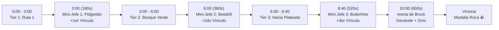
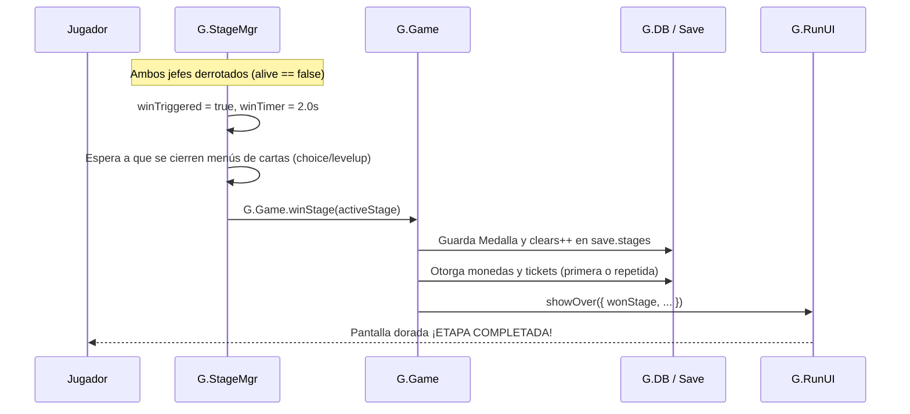

# Sistema de Etapas y Gimnasios de Kanto

Este documento recoge todo el diseño, arquitectura técnica, fases minuto a minuto y progresión del **Sistema de Etapas y Gimnasios de Kanto** en PokéSurvivor.

---

## 1. Visión General y Filosofía de Diseño

Históricamente, PokéSurvivor contaba exclusivamente con un **Modo Infinito Tradicional** (supervivencia pura sin fin, con escalado implacable de oleadas y enemigos aleatorios de las 9 generaciones).

El **Sistema de Etapas** introduce una estructura de campaña clásica inspirada en *Vampire Survivors* y el recorrido de los juegos principales de Pokémon:
* **Partidas estructuradas de 10 minutos (600 segundos):** Cada etapa tiene un arco narrativo y jugable claro: apertura, desarrollo, clímax y combate final.
* **Elenco de Pokémon temático:** Los enemigos que aparecen en cada minuto son autóctonos de las rutas y zonas representadas (ej. Ruta 1, Bosque Verde, Monte Moon).
* **Curva de poder acelerada:** Con un multiplicador de experiencia incrementado (`xpMul: 1.4`) y multiplicadores de atributos equilibrados (`hpMul: 0.85`, `dmgMul: 1.1`), el jugador puede desarrollar una build completa de 4 movimientos y fusiones antes de llegar al líder.
* **Progresión por medallas:** Vencer al líder de gimnasio otorga la medalla oficial de la región, desbloquea recompensas especiales y marca el hito en el perfil del jugador.
* **Exclusivo para Un Jugador (Single Player):** El Sistema de Etapas y Gimnasios está concebido como una experiencia de campaña individual. Las partidas multijugador cooperativas en sala **no modifican su flujo bajo ningún concepto**: al pulsar empezar desde el lobby cooperativo, los jugadores continúan entrando directamente al **Modo Infinito Tradicional** sin selector de etapas ni combates de gimnasio.
* **Coexistencia con el Modo Infinito:** Ambos modos conviven en armonía; el jugador elige en solitario si afrontar un Gimnasio o competir por récord en el Modo Infinito Tradicional. En multijugador, la partida siempre inicia en el Modo Infinito.

---

## 2. Hoja de Ruta y Curva de Progresión (Gimnasios 1 al 8)

El objetivo de diseño de la curva es que el **Gimnasio 1 (Brock)** sea accesible y permisivo, y que el **Gimnasio 8 (Giovanni)** iguale en su minuto 10 la intensidad, vida y daño del **Modo Infinito al minuto 10** (~9.000 PS por mob, ~160 daño, ~25.000 PS totales de jefe).

Para evitar saturar la arena circular (radio 12 casillas), **la regla de oro de la batalla final es un máximo de 2 Pokémon activos simultáneamente**. Los combates con 3 o más Pokémon se dividen en **fases/tandas consecutivas** con una breve pausa de 2.5s entre ellas.

| Etapa | Zona / Recorrido | Líder | Medalla | Multiplicadores (`hpMul` / `dmgMul`) | Estructura del Combate Final (Máx. 2 activos) | Recompensa (1ª vez / Repetida) | Estado |
| :---: | :--- | :--- | :---: | :---: | :--- | :--- | :---: |
| **1** | Ruta 1, Bosque Verde y Plateada | **Brock** | Roca 🪨 | `0.85` / `1.10` | **1 Fase (Dúo):** Geodude (2.4k) + Onix (3.8k) = **6.200 PS** | 500c + 10t / 150c + 1t | **Disponible** |
| **2** | Monte Moon, Ruta 24 y Celeste | **Misty** | Cascada 💧 | `1.15` / `1.25` | **2 Fases (1+1):** F1 Staryu (3.5k) $\to$ F2 Starmie (5.0k) = **8.500 PS** | 750c + 10t / 200c + 1t | *Próximamente* |
| **3** | Cueva Diglett, S.S. Anne y Carmín | **Lt. Surge** | Trueno ⚡ | `1.50` / `1.45` | **2 Fases (2+1):** F1 Voltorb (3.2k) + Pikachu (3.8k) $\to$ F2 Raichu (5.5k) = **12.500 PS** | 1.000c + 20t / 250c + 2t | *Próximamente* |
| **4** | Túnel Roca, Ruta 7 y Azulona | **Erika** | Arcoíris 🌿 | `1.95` / `1.70` | **2 Fases (2+1):** F1 Tangela (4.2k) + Victreebel (4.8k) $\to$ F2 Vileplume (6.0k) = **15.000 PS** | 1.250c + 20t / 300c + 2t | *Próximamente* |
| **5** | Ruta 17 (Ciclista) y Fucsia | **Koga** | Alma 💜 | `2.55` / `2.00` | **2 Fases (2+1):** F1 Koffing (4.5k) + Muk (6.0k) $\to$ F2 Weezing (7.5k) = **18.000 PS** | 1.500c + 20t / 350c + 2t | *Próximamente* |
| **6** | Silph S.A. y Ciudad Azafrán | **Sabrina** | Pantano 👁️ | `3.30` / `2.35` | **2 Fases (2+1):** F1 Kadabra (5.5k) + Mr. Mime (5.5k) $\to$ F2 Alakazam (8.5k) = **19.500 PS** | 1.750c + 30t / 400c + 3t | *Próximamente* |
| **7** | Ruta 20, Mansión Pokémon y Canela | **Blaine** | Volcán 🔥 | `4.25` / `2.75` | **2 Fases (2+1):** F1 Growlithe (5.5k) + Rapidash (7.0k) $\to$ F2 Arcanine (10.0k) = **22.500 PS** | 2.000c + 30t / 450c + 3t | *Próximamente* |
| **8** | Calle Victoria y Ciudad Verde | **Giovanni** | Tierra 🌍 | **`5.50`** / **`3.20`** | **2 Fases (2+2):** F1 Dugtrio (5.5k) + Nidoqueen (6.5k) $\to$ F2 Nidoking (6.5k) + Rhydon (7.5k) = **26.000 PS** | 2.500c + 50t / 500c + 4t | *Próximamente* |

---

## 3. Fases Minuto a Minuto de una Etapa (Ejemplo: Etapa 1)

Cada etapa se divide en fases temporales organizadas en tres oleadas de enemigos, tres mini-jefes estratégicos y la arena final del líder:



### Fase 1: Ruta 1 y Entrada al Bosque (0:00 – 3:00)
* **Enemigos salvajes (Tier 1):** Pidgey (#16), Rattata (#19), Caterpie (#10) y Weedle (#13).
* **BST (Base Stat Total):** 180 – 270.
* **Objetivo:** Recolectar gemas de experiencia iniciales, subir los primeros 8-12 niveles y desbloquear los 4 espacios de movimientos del Pokémon compañero.

### Mini-Jefe 1 (Minuto 3:00 / 180s): Pidgeotto Alfa
* **Estadísticas:** 1.100 PS, 22 Daño, comportamiento embestidor (`charger`).
* **Botín:**
  * 1 Objeto equipable garantizado (`G.Items.roll()`).
  * **1er Vínculo de Habilidad (`pl.bonds++`):** Abre la interfaz de Vínculos para fusionar 2 movimientos en un único ataque combinado.

### Fase 2: Profundidades del Bosque Verde (3:00 – 6:00)
* **Enemigos salvajes (Tier 2):** Metapod (#11), Kakuna (#14), Pikachu (#25), Nidoran♀ (#29) y Nidoran♂ (#32).
* **BST:** 200 – 330.
* **Dinámica:** La densidad de enemigos aumenta significativamente. Aparición de enemigos con proyectiles eléctricos y venenosos.

### Mini-Jefe 2 (Minuto 6:00 / 360s): Beedrill Enjambre
* **Estadísticas:** 1.900 PS, 26 Daño, persecución implacable (`chase`).
* **Botín:**
  * 1 Objeto equipable garantizado.
  * **2do Vínculo de Habilidad:** Permite unir un tercer movimiento al grupo o formar dos parejas de movimientos fusionados.

### Fase 3: Salida del Bosque y Acercamiento a Plateada (6:00 – 8:40)
* **Enemigos salvajes (Tier 3):** Spearow (#21), Zubat (#41), Pidgeotto (#17), Butterfree (#12) y Beedrill (#15).
* **BST:** 300 – 420.
* **Dinámica:** Enemigos rápidos y resistentes. El `xpMul: 1.4` permite alcanzar niveles 35-45 antes del combate final.

### Mini-Jefe 3 (Minuto 8:40 / 520s): Butterfree Alfa
* **Estadísticas:** 2.500 PS, 28 Daño, patrón de proyectiles en abanico (`fan`).
* **Botín:**
  * 1 Objeto equipable garantizado.
  * **3er Vínculo de Habilidad:** Permite completar la **fusión cuádruple** (los 4 movimientos disparados al unísono con cada ciclo de ataque).

### Fase 4: Combate de Gimnasio en la Arena (Minuto 10:00 / 600s en adelante)
Al llegar al segundo 600 exacto:
1. **Detención del generador común:** No aparecen más enemigos salvajes.
2. **Limpieza del campo (`stash`):** Todos los enemigos comunes en pantalla se ocultan, y se eliminan proyectiles y trampas residuales.
3. **Construcción de la Arena:** Se genera una arena circular cerrada (radio 12 casillas, centrada en coordenadas 5000, 5000) con tiles y bioma representativo del líder.
4. **Teletransporte:** El jugador es transportado a la parte inferior de la arena (modo exclusivo Single Player).
5. **Regla de Oro del Combate de Gimnasio (Máximo 2 Pokémon activos):**
   * Para evitar saturar la arena circular de 12 casillas, **nunca habrá más de 2 Pokémon del líder activos simultáneamente**.
   * Si el equipo del líder tiene 3 o más Pokémon (como Surge, Erika, Koga, Sabrina, Blaine o Giovanni), la batalla se organiza en **fases o tandas consecutivas**:
     * **Tanda 1:** Se enfrentan los 1 o 2 primeros Pokémon del líder.
     * **Transición (2.5 segundos):** Al derrotar la tanda, hay un destello visual suave, fanfarria corta y un anuncio en pantalla (ej. *"¡Líder Giovanni retira a sus Pokémon y envía a su artillería pesada!"*). Esto da un respiro táctico para absorber gemas caídas y reposicionarse en la arena.
     * **Tanda 2:** Aparece el Pokémon "As" del líder (o el segundo dúo en el caso de Giovanni).
6. **Muro de contención (`keepInside`):** Una barrera física circular impide tanto al jugador como a los Pokémon del líder salir de la arena en todas las fases.

*Ejemplo en la Etapa 1 (Brock):* Al constar de solo 2 Pokémon (Geodude 2.4k PS + Onix 3.8k PS), el combate se resuelve en una única fase donde ambos luchan juntos. En etapas posteriores (ej. Giovanni), se dividen en 2 tandas de 2 Pokémon (Dugtrio + Nidoqueen $\to$ Nidoking + Rhydon).

---

## 4. Condición de Victoria y Flujo de Fin de Partida



1. **Detección de Derrota:** Cuando la salud de Geodude y Onix llega a 0, se activa el estado `gymState = 'won'`.
2. **Temporizador Seguro:** Se esperan 2 segundos continuos de fotogramas, comprobando que el jugador no tenga abierta ninguna carta de selección (`choice`) ni subida de nivel (`levelup`).
3. **Invocación de Victoria:** Se ejecuta `G.Game.winStage(activeStage)`.
4. **Otorgamiento de Recompensas:**
   * Si es la **primera victoria:** Se añade la medalla a `save.badges`, se otorgan 500 monedas y 10 tickets de gacha.
   * Si es una **victoria repetida:** Se otorgan 150 monedas y 1 ticket de gacha adicional.
5. **Pantalla de Resumen (`RunUI.showOver`):**
   * Título dorado: `¡ETAPA COMPLETADA!`
   * Subtítulo con la medalla obtenida o etiqueta de `Victoria Repetible`.
   * Banner conmemorativo: *"¡Has derrotado al Líder Brock en el Gimnasio Plateada!"*.
   * Desglose detallado de monedas, tickets y estadísticas de la partida.

---

## 5. Integridad de Estadísticas y Aislamiento del Ranking

Un principio fundamental del diseño fue **no alterar la integridad del Modo Infinito**:

* **Récord de Tiempo (`bestTime`):** Completar una etapa en 10 minutos **no** sobreescribe ni afecta al récord histórico de supervivencia del jugador en el modo infinito.
* **Aislamiento Total del Modo Multijugador:** Las partidas multijugador cooperativas no admiten el selector de etapas ni mecánicas de gimnasio. El anfitrión y sus compañeros inician directamente en el Modo Infinito Tradicional, preservando la sincronización de red P2P/relay, el ranking grupal (`bestGroupTime`) y la experiencia multijugador clásica intacta.
* **Tablas de Clasificación Global (Ranking):** Las partidas de etapas no envían marcas a los rankings mundiales de Firebase. Los marcadores globales siguen midiendo exclusivamente la habilidad de supervivencia en el Modo Infinito Tradicional.
* **Guardado Independiente:** El progreso de las etapas se almacena en su propia rama del guardado local y en la nube:
  ```json
  {
    "stages": {
      "kanto_1": {
        "completed": true,
        "clears": 3,
        "at": 1728840715000
      }
    },
    "badges": {
      "roca": true
    }
  }
  ```

---

## 6. Arquitectura Técnica de Código

El sistema está construido de forma modular a través de los siguientes archivos:

### `js/data/stages.js`
* Objeto de definición `G.Stages`.
* Contiene el array `LIST` con la configuración de las 8 etapas de Kanto: metadatos, líderes, medallas, duraciones, multiplicadores (`hpMul`, `dmgMul`, `xpMul`), tiers de Pokémon, mini-jefes intermedios, equipo del líder y recompensas.
* Proporciona métodos de consulta: `G.Stages.get(id)`, `G.Stages.current` y `G.Stages.clearCurrent()`.

### `js/systems/stages.js`
* Controlador en tiempo real `G.StageMgr`.
* Gestiona el ciclo de vida: `begin(stageId)`, `tick(dt, time, pl)` y `end()`.
* Controla los estados del gimnasio: `'none'`, `'battle'`, `'won'`, `'ended'`.
* Ejecuta la transición hacia la arena: limpieza del mapa con `G.EnemyMgr.stash()`, construcción de muros con `G.World.setArena()`, y confinamiento con `keepInside()`.
* Conecta el evento `onBossKilled(enemy)` para entregar automáticamente los Vínculos de habilidad (`pl.bonds++`) tras vencer a los mini-jefes.

### `js/data/enemies.js` & `js/systems/spawner.js`
* Adaptación de `rollRun()`: si hay una etapa activa, carga el elenco exclusivo de dicha etapa en lugar de sortear entre las 9 generaciones.
* Asigna los mini-jefes definidos en `miniBosses` para que aparezcan en los segundos exactos (180s, 360s, 520s).
* Pausa la generación de enemigos salvajes y mareas una vez iniciada la batalla de gimnasio.

### `js/game.js`
* Entrada a la partida con `startRun(coop, stageId)`:
  * Si `coop` viene definido (partida multijugador), ejecuta preventivamente `G.StageMgr.end()` para asegurar que las partidas en grupo siempre corran 100% en el Modo Infinito Tradicional.
  * Si se juega en solitario con `stageId`, inicializa la etapa correspondiente mediante `G.StageMgr.begin(stageId)`.
* Invocación de fin de partida victorioso mediante `winStage(stage)`.
* Gestión de entrega de recompensas (primera vs repetida) y compromiso de datos con `G.DB.commit()`.

### `js/ui/menu.js` & `js/ui/run-ui.js`
* **Botón Jugar y Selector de Modos:**
  * Si el jugador se encuentra en una sala cooperativa (`G.Social.room`), el botón "Jugar" abre directamente la sala de espera (`G.LobbyUI.open()`), desde donde el anfitrión inicia la partida directo al Modo Infinito.
  * Si el jugador está en solitario (Single Player), el botón "Jugar" abre el selector de etapas (`openStageSelect()`), permitiéndole elegir entre "Modo Infinito Tradicional" o desafiar a los "Gimnasios de Kanto".
  * Renderizado de badges y sprites de líderes obtenidos desde `assets/gyms/`.
  * Estados visuales claros: etapas completadas con medalla dorada, botón "Jugar Etapa" y etapas aún no programadas (etiqueta "PRÓXIMAMENTE").
* **Pantalla de Victoria:** Presentación festiva con sprite de la medalla y desglose de recompensas.

---

## 7. Assets Visuales Vinculados

Los assets de líderes y medallas se encuentran optimizados en pixel art dentro del directorio `assets/gyms/`:

* **Medallas:** `assets/gyms/kanto_1_badge.png` hasta `kanto_8_badge.png`.
* **Líderes de Gimnasio:** `assets/gyms/kanto_1_leader.png` hasta `kanto_8_leader.png`.
* **Herramienta de extracción:** `tools/fetch_gym_assets.py` permite regenerar o actualizar los sprites originales de la región.
